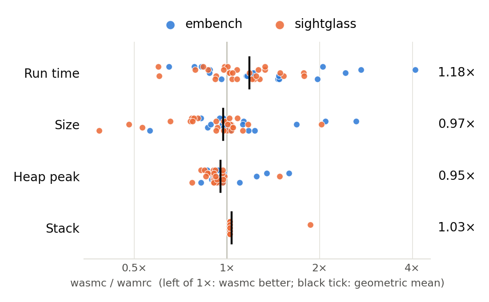
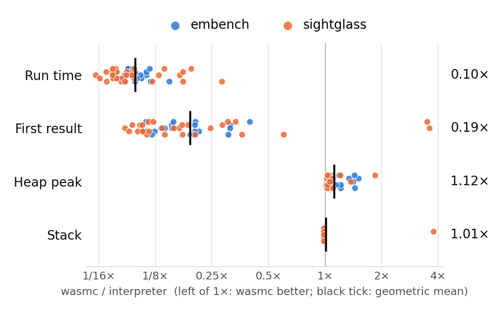
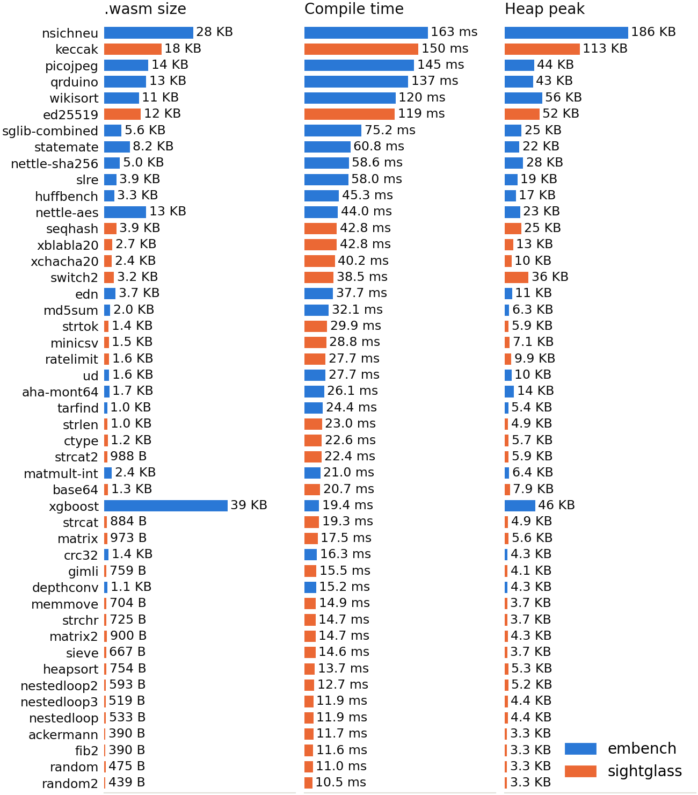

# wasmc on the ESP32-C3

Every WebAssembly module is run on an ESP32-C3 (RISC-V) in three modes:

- **wasmc AOT**: the board gets the `.wasm` and compiles it itself, with
  wasmc, to an AOT file (native RISC-V code); WAMR's AOT runtime then loads
  and runs it. Its time to first result includes this compile.
- **wamrc AOT**: the `.wasm` is compiled on the host with wamrc, WAMR's own
  AOT compiler (based on LLVM); the board gets the finished AOT file and the
  same runtime loads and runs it. The reference for the quality of wasmc's
  code, with no compile on the board.
- **interpreter**: the board runs the `.wasm` as it is, with WAMR's fast
  interpreter: no compile, but slower code.

Each module runs 3 times in a row after one boot (the first run
cold: its code still read from flash); every figure is the median of the
runs.

## Summary

- wasmc AOT vs interpreter: **10.2× faster** (run time, geometric mean of 47 modules)
- wasmc AOT vs wamrc AOT: **18% slower** (run time, geometric mean of 47 modules)
- wasmc AOT file size: **3% smaller than wamrc's** (geometric mean of 47 modules)
- On-device compile, 47 modules: **24.4 ms** median time, **6.4 KB** median heap peak

  |              | min| 25%|median| 75%|  max|mean (arith.)|
  |:-------------|---:|---:|-----:|---:|----:|------------:|
  |Time (ms)     |10.5|15.0|  24.4|43.4|162.9|         41.3|
  |Heap peak (KB)| 3.3| 4.4|   6.4|22.6|186.2|         19.8|

- Correctness: **47 of 47** modules return the same result in all 3 modes (interpreter, wamrc AOT, wasmc AOT)

## wasmc vs wamrc, module by module

Each row is one figure measured on both AOT files, and each dot one module,
placed at wasmc's value divided by wamrc's: left of the grey 1× line wasmc
does better, right of it worse. The scale is logarithmic, so 2× and 0.5×
are the same distance from 1×. The black tick, and the number on the right,
is the geometric mean of all the modules; the colors are the suites.
The rows:

- **Run time**: the call of the module's entry function (`__main_void`) alone, once the module is loaded and instantiated.
- **Size**: the file the runtime loads into RAM: the AOT file each compiler makes.
- **Heap peak**: the most heap in use at once while loading, instantiating and running: the module's copy in RAM, the loaded module, and the instance with its linear memory and its 16 KB WAMR stack.
- **Stack**: the native stack used by the thread that loads, instantiates and runs the module.

## wasmc vs the interpreter, module by module

The same, against WAMR's fast interpreter running the `.wasm`: each dot is
wasmc's value divided by the interpreter's, left of 1× wasmc does better.
The rows:

- **Run time**: the call of the module's entry function (`__main_void`) alone, once the module is loaded and instantiated.
- **First result**: from the module in RAM to the entry's result: load + instantiate + run, plus, for wasmc, its compile on the device.
- **Heap peak**: the most heap in use at once while loading, instantiating and running: the module's copy in RAM, the loaded module, and the instance with its linear memory and its 16 KB WAMR stack.
- **Stack**: the native stack used by the thread that loads, instantiates and runs the module.

## Compile on the device: time and heap

What `wasmc_compile()` costs on the board, one row per module, the slowest
at the top. From left to right: the size of the module's `.wasm`, how long
the compile takes, and the most heap it uses at once (its work memory, plus
the AOT file it writes). Each panel has its own scale; the colors are the
suites. Time and heap mostly grow with the size, but not always: a module
can be big because of its data, which costs little to compile.

## Sources

The figures come from these runs of `scripts/run.sh`, one per mode and
suite. Each results directory, in `results/`, holds per module the raw
measures the board printed (`<module>.out`) and the build and flash log
(`<module>.log`).
The runs were made on 2026-11-21, from 16:39 to 17:17; the firmware (with WAMR and wasmc) was built with `-O2`; each module ran 3 times in a row after one boot.

| Mode        | Suite      | Modules | Results directory        |
|:------------|:-----------|--------:|:-------------------------|
| wasmc AOT   | embench    |      19 | `wasmc-20261121-163913`  |
| wasmc AOT   | sightglass |      28 | `wasmc-20261121-164626`  |
| wamrc AOT   | embench    |      19 | `aot-20261121-165600`    |
| wamrc AOT   | sightglass |      28 | `aot-20261121-170235`    |
| interpreter | embench    |      19 | `interp-20261121-171058` |
| interpreter | sightglass |      28 | `interp-20261121-171758` |

### How the modules were built

The modules are C benchmarks compiled to WebAssembly by `suites/build.sh`
(one `compile.sh` per suite):

- **embench** (source at commit 09c2ed8, 2026-02-13): the Embench IoT benchmarks, one pass of each benchmark's loop (`GLOBAL_SCALE_FACTOR=1`) and no warm-up. The entry returns `benchmark()`'s result, or `0xbad00000 ^ result` if Embench's own check rejects it.
- **sightglass** (source at commit d76a8bf, 2022-10-27): the shootout kernels of the Bytecode Alliance's Sightglass; those too big for the ESP32-C3's memory made smaller with `-DESP32` or a patch (`suites/sightglass/patches/`). The entry returns a hash of the values the kernel passes to `BLACK_BOX()`.
- **Compiler**: clang, `--target=wasm32 -mcpu=mvp -Os`: WebAssembly 1.0
  only (no sign-extension, bulk memory or later features), optimized for
  size. Linked by `wasm-ld` without `-O`, which would let clang run
  `wasm-opt` and add later opcodes. The modules don't
  record which clang built them; the machine that made this summary has
  Debian clang version 19.1.7 (3+b1).
- **No system libc**: a small one of the project (`suites/libc/`), with no
  output; `malloc` takes its memory from a fixed arena in the module's
  linear memory (4.0 KB for embench, 64 KB for sightglass), which never grows.
- **Entry**: the firmware calls `__main_void`, exported by each suite's
  `entry.c`; its 32-bit result is the value the correctness check compares
  across the three modes.
- **Memory**: 16 KB of C stack in the linear memory;
  names and debug information stripped; `__heap_base` and
  `__data_end` exported, so that wamrc and wasmc can shrink the linear
  memory to what the module uses.

This document was generated on 2026-11-21 17:57:35 by `scripts/summary.py`.
